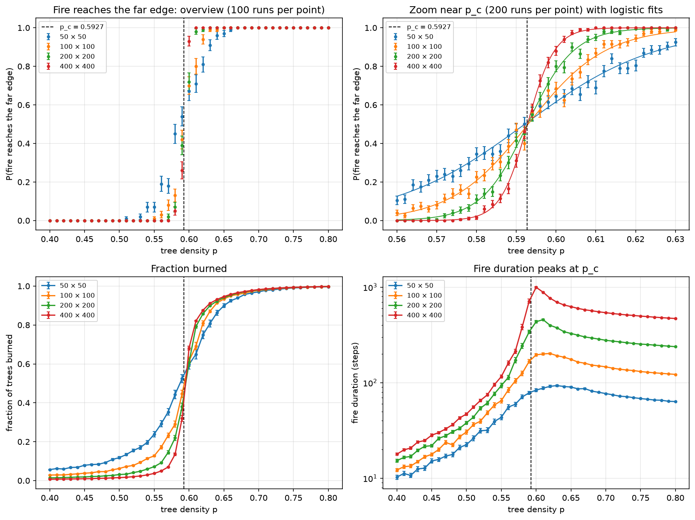
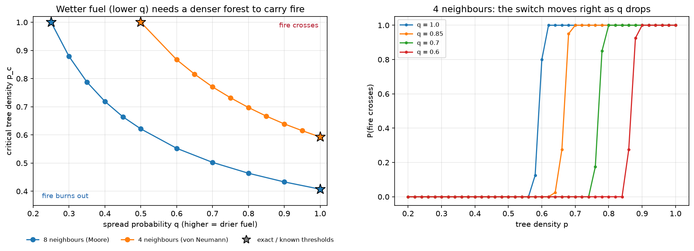
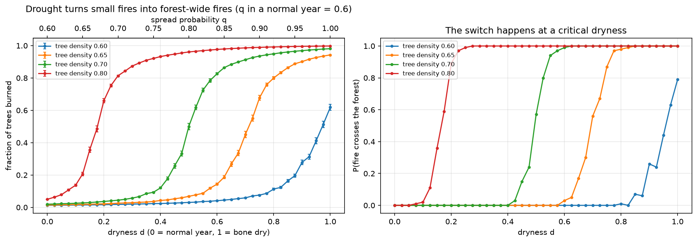
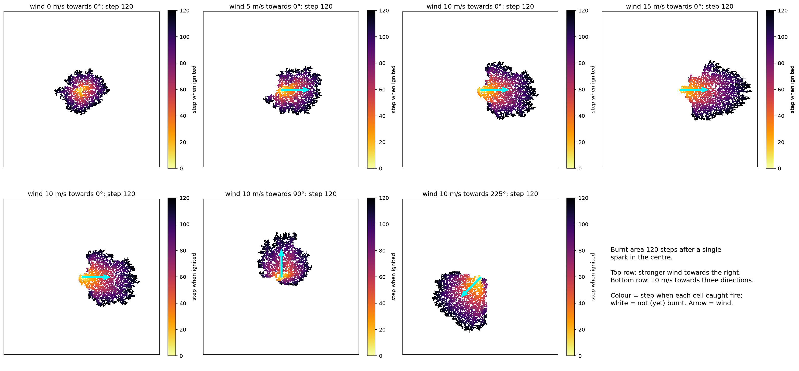
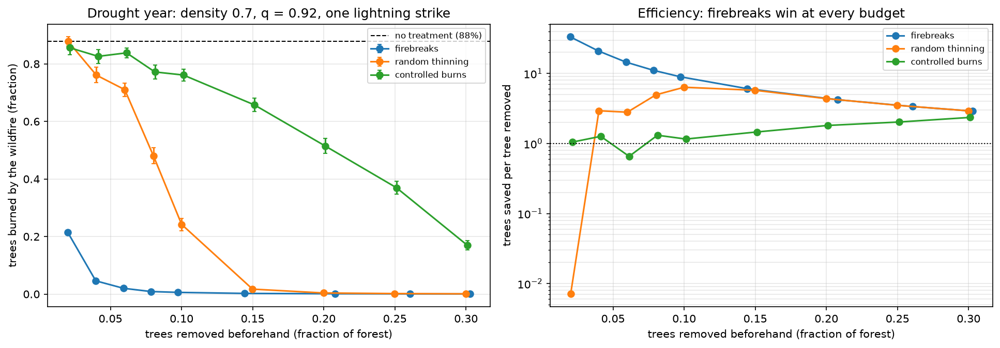
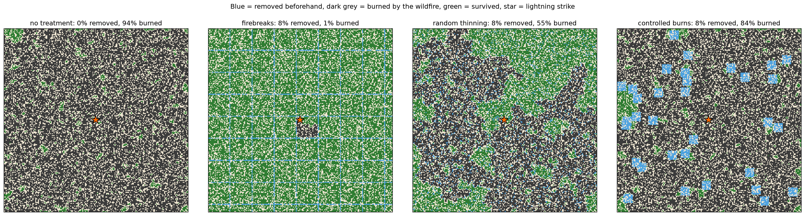
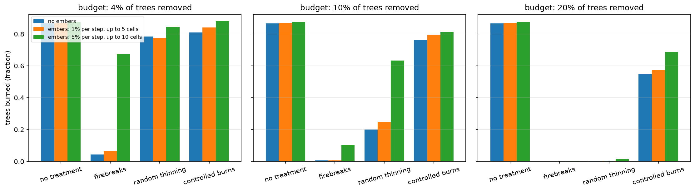
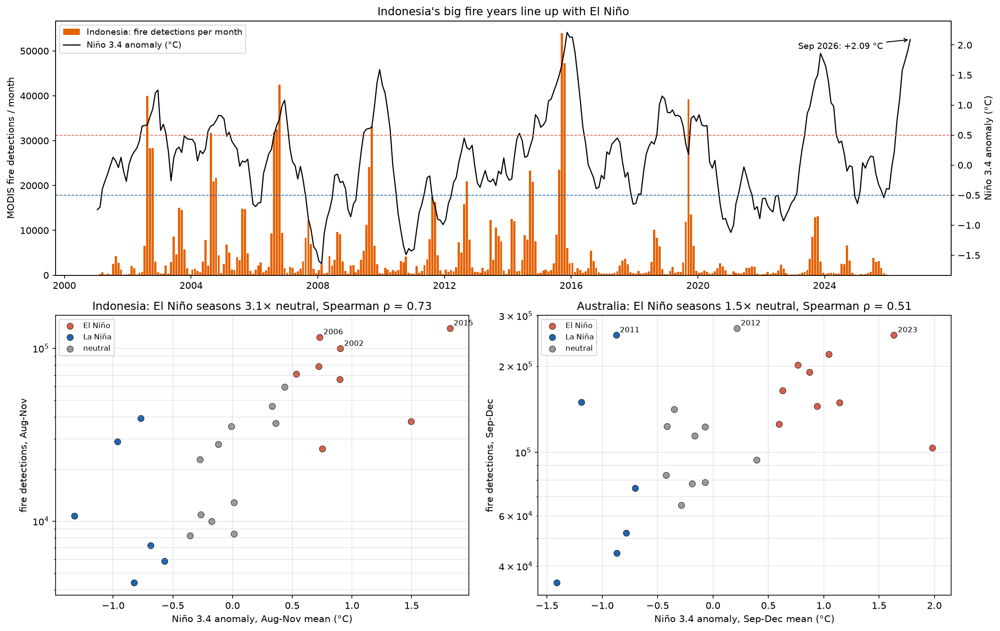

```{python}
#| echo: false
#| output: false
import json
import sys
from pathlib import Path

sys.path.insert(0, "../src")
import pandas as pd

R = Path("../results")
def meta(name):
    return json.loads((R / name / "settings.json").read_text())
def data(name):
    return pd.read_csv(R / name / "data.csv")

p1 = meta("phase1_percolation")["summary"]
fits1 = pd.DataFrame(p1["fits"])
p2 = meta("phase2_critical_density")["summary"]
fits2 = pd.DataFrame(p2["fits"])
bond = pd.DataFrame(p2["bond_thresholds"])
crit_d = pd.DataFrame(meta("phase3_drought")["summary"]["critical_dryness"])
drought = data("phase3_drought")
wind = pd.DataFrame(meta("phase3_wind")["summary"]["by_wind_speed"]).set_index("wind_speed")
mg = pd.DataFrame(meta("phase4_management")["summary"]["summary"])
emb = data("phase4_embers")
p5 = meta("phase5_enso_fire")["summary"]
indo, aus = p5["by_country"]["Indonesia"], p5["by_country"]["Australia"]
ctx = p5["context_2026"]

def pc(nb, q):
    return fits2[(fits2.neighbourhood == nb) & (fits2.q == q)]["p50"].iloc[0]
def loss(strategy, budget):
    return mg[(mg.strategy == strategy) & (mg.budget == budget)]["loss"].iloc[0]
def eff(strategy, budget):
    return mg[(mg.strategy == strategy) & (mg.budget == budget)]["trees_saved_per_tree_removed"].iloc[0]
base = mg[mg.strategy == "none"]["loss"].iloc[0]
def phase_ratio(c):
    return [r for r in c["by_phase"] if r["phase"] == "El Niño"][0]["mean_vs_neutral"]
f400 = fits1.set_index("size").loc[400]
d65 = drought[drought.density == 0.65].set_index("dryness")["fraction_burned"]
def emb_loss(strategy, budget, scenario):
    return emb[(emb.strategy == strategy) & (emb.budget == budget) & (emb.scenario == scenario)]["loss"].iloc[0]
STRONG = "embers: 5% per step, up to 10 cells"
```

::: {.callout-note appearance="simple"}
## Summary

* **A sharp tipping point.** Fire crosses a random forest only when tree cover exceeds a critical density. The
  model finds p_c = `{python} f"{f400['p50']:.4f}"` on a 400 × 400 forest, against the exact percolation value 0.5927,
  and reproduces three other known thresholds and the finite-size scaling exponent.
* **Drought moves the tipping point.** Wetter fuel needs a denser forest to carry fire: p_c rises from 0.593 to
  `{python} f"{pc('von_neumann', 0.8):.2f}"` when the spread chance falls to 0.8. Read the other way, drought lowers
  the threshold. A 65%-cover forest that burns `{python} f"{d65[0.0]:.1%}"` in a normal year burns
  `{python} f"{d65[0.8]:.0%}"` at dryness 0.8.
* **Wind** at 10 m/s more than doubles the fire's head speed (`{python} f"{wind.loc[10.0, 'head_speed'] / wind.loc[0.0, 'head_speed']:.1f}"`×)
  and nearly stalls its back.
* **Breaking connectivity beats removing fuel.** Under drought, firebreaks save
  `{python} f"{eff('firebreaks', 0.04):.0f}"` trees per tree removed at a 4% budget. Random thinning saves
  `{python} f"{eff('thinning', 0.04):.1f}"` and random controlled-burn patches `{python} f"{eff('controlled_burns', 0.04):.1f}"`.
  Strong ember spotting can breach widely spaced breaks.
* **The real world agrees.** In NASA satellite data for 2001–2025, Indonesian fire seasons in El Niño years average
  `{python} f"{phase_ratio(indo):.1f}"`× the fire detections of neutral years (rank correlation with Niño 3.4:
  `{python} f"{indo['spearman_rho']:.2f}"`). Australia shows a weaker link (`{python} f"{phase_ratio(aus):.1f}"`×, ρ =
  `{python} f"{aus['spearman_rho']:.2f}"`). The Niño 3.4 anomaly reached
  **+`{python} f"{ctx['latest_nino34']['value']:.2f}"` °C** in September 2026.
:::

# Why fires, why El Niño

El Niño warms the central and eastern tropical Pacific and shifts rainfall away from the Maritime Continent and
Australia. Dry seasons there become drier and longer. In Indonesia that has repeatedly meant catastrophic peat and
forest fires (1997, 2015), with smoke haze across Southeast Asia. In Australia it raises fire danger in the spring
and summer fire season. A strong El Niño was developing through 2026.

This project asks a simple physical question with a non-obvious answer: **how does a landscape go from having small
fires to having forest-wide fires?** Percolation theory predicts the answer is not gradual. There is a critical
point, and conditions just on either side of it produce very different fire seasons. The project builds that idea
up in steps, checks each step against known exact results, and then tests the El Niño connection against real data.

# The model

The forest is a square grid. Each cell is a tree with probability p (the **density**), otherwise bare ground. Fire
starts at a chosen place. At every step each burning tree tries to ignite its neighbouring trees, succeeding with
probability q, and then burns out. Each phase adds one ingredient:

| Phase | Ingredient | Question |
|---|---|---|
| 1 | Deterministic spread (q = 1) to the 4 side neighbours | Where is the critical density? |
| 2 | Spread probability q; optional 8 neighbours | How does fuel moisture move it? |
| 3 | Dryness (drought) and wind | How do El Niño-like conditions change fire size, speed and shape? |
| 4 | Firebreaks, thinning, controlled burns; ember spotting | Which treatment saves most forest per tree removed? |
| 5 | NASA FIRMS fire detections vs NOAA Niño 3.4 | Do real fire seasons follow El Niño? |

The core loop is compiled with Numba and keeps a list of burning cells, so a 200 × 200 fire takes about a
millisecond. Each fire is recorded as the step at which every cell ignited, which drives the animations and the
fire-shape measurements. Every result in `results/` stores its settings, random seed and library versions.

# Phase 1: the critical density

The whole left edge is lit and fire spreads to side neighbours only, so the fire burns exactly the trees connected
to the left edge. Whether it reaches the right edge is the classic **site percolation** problem.



```{python}
#| label: tbl-p1
#| tbl-cap: "Logistic fits of the crossing probability (200 forests per density near p_c)."
t = fits1[["size", "p50", "p50_err", "width"]].rename(columns={"p50": "half-way density", "p50_err": "± (fit)", "width": "transition width"})
t.round(4)
```

* The half-way point sits at **0.593 for every size**, matching the exact value 0.592746.
* The switch **sharpens with size**: its width scales as L^`{python} f"{p1['width_exponent']:.2f}"`. Theory predicts
  L^−3/4, because the correlation-length exponent is ν = 4/3. In an infinite forest it would be a perfect jump.
* **Fires last longest at p_c.** Right at the threshold the burning path is a long, winding chain, a signature of
  critical behaviour.

# Phase 2: fuel moisture moves the threshold

Now each attempt succeeds with probability q, which stands in for how readily the fuel catches. Lower q means wetter
fuel.



| Check | Model | Known |
|---|---|---|
| 4 neighbours, q = 1 | `{python} f"{pc('von_neumann', 1.0):.4f}"` | 0.5927 |
| 8 neighbours, q = 1 | `{python} f"{pc('moore', 1.0):.4f}"` | 0.4073 |
| Full forest, 4 neighbours (bond threshold) | q = `{python} f"{bond.set_index('neighbourhood').loc['von_neumann','q50']:.4f}"` | 1/2 exactly |
| Full forest, 8 neighbours | q = `{python} f"{bond.set_index('neighbourhood').loc['moore','q50']:.4f}"` | ≈ 0.2504 |

**Wetter fuel needs a denser forest to carry fire.** With 4 neighbours p_c rises from 0.593 to
`{python} f"{pc('von_neumann', 0.8):.3f}"` at q = 0.8 and `{python} f"{pc('von_neumann', 0.6):.3f}"` at q = 0.6. Below
q = 1/2, no forest of any density carries fire across. Letting fire jump diagonally lowers every threshold, a
reminder that how far fire can reach matters as much as how much fuel there is.

# Phase 3: drought and wind

## Drought

A **dryness** d between 0 (normal year) and 1 (bone dry) shrinks the chance that fuel fails to catch:
q = 1 − (1 − q_normal)(1 − d), with q_normal = 0.6. This is an illustrative mapping, not a calibrated fuel-moisture
model. The same forests are burned at every dryness level.



```{python}
#| label: tbl-dry
#| tbl-cap: "Critical dryness: the drought level at which half the fires cross the forest."
crit_d.rename(columns={"d50": "critical dryness", "d50_err": "± (fit)"}).round(3)
```

The switch from small to forest-wide fires now happens at a **critical dryness**, and the denser the forest, the
less drought it takes. This is the core El Niño mechanism in the model. A landscape that sits just below its
threshold in a normal year can be pushed well past it in a drought year without gaining a single tree, so the fire
season changes in kind, not only in degree.

## Wind

Wind multiplies each neighbour's spread chance by e^(0.131·V·cos θ), where V is the wind speed in m/s and θ is the
angle between the wind and the direction of spread. The coefficient 0.131 is the angular wind factor fitted by
Alexandridis et al. (2008) to a real wildfire. Two modelling choices were needed:

* **Burn duration.** Trees smoulder for 10 steps and keep trying their neighbours. With one-step burning, any
  surviving fire advances at the grid's speed limit, so wind could change where fire goes but not how fast.
* **No overall wind penalty.** The original model also has a factor that lowers spread in every direction as wind
  rises. Fitted jointly with that model's other parameters, it made stronger wind produce smaller fires here, so it
  is left out.



```{python}
#| label: tbl-wind
#| tbl-cap: "Fire speed (cells per step) and shape for a spark in a dense, dry forest (60 forests per wind speed)."
wind[["head_speed", "back_speed", "length_to_width"]].rename(columns={"head_speed": "head speed", "back_speed": "back speed",
     "length_to_width": "length / width"}).round(3)
```

At 10 m/s the head runs `{python} f"{wind.loc[10.0, 'head_speed'] / wind.loc[0.0, 'head_speed']:.1f}"`× faster than in
still air and the back about `{python} f"{wind.loc[0.0, 'back_speed'] / wind.loc[10.0, 'back_speed']:.0f}"`× slower.
The fire becomes egg-shaped, with the spark at its back edge. Above about 12 m/s the head reaches the grid's speed
limit. The stretching (length/width ≈ 1.2–1.3) is much milder than in real wind-driven fires, because the flanks
still spread at their still-air speed and nothing throws embers ahead of the front.

# Phase 4: fire management

A drought year (density 0.7, q = 0.92) and a single lightning strike on a random tree. Before the season some trees
are removed by one of three strategies, all tested on the same 100 forests and strikes:

* **firebreaks:** a grid of cleared lines;
* **random thinning:** trees removed at random everywhere;
* **controlled burns:** square patches burned on purpose beforehand.





* **Firebreaks win at every budget.** Removing 2% of trees cuts the burn from `{python} f"{base:.0%}"` to
  `{python} f"{loss('firebreaks', 0.02):.0%}"`, which is `{python} f"{eff('firebreaks', 0.02):.0f}"` trees saved per tree
  removed. Breaks cut the forest into compartments smaller than the fire's reach, so a fire is trapped where it starts.
* **Thinning has a cliff.** It barely helps until it pushes the forest below the critical density (≈ 0.63 at
  q = 0.92). Then the burn collapses: `{python} f"{loss('thinning', 0.10):.0%}"` at 10% removed and
  `{python} f"{loss('thinning', 0.15):.0%}"` at 15%.
* **Random controlled-burn patches are weakest.** Scattered patches never cut the forest's connectivity. Even 30%
  removed leaves `{python} f"{loss('controlled_burns', 0.30):.0%}"` burned. Burns laid out as strips would act like
  firebreaks.
* **Embers matter.** If burning trees can throw embers (5% per step, landing up to 10 cells away), widely spaced
  breaks (4% budget) let `{python} f"{emb_loss('firebreaks', 0.04, STRONG):.0%}"` of the forest burn. Closely spaced
  ones (10%) still hold it to `{python} f"{emb_loss('firebreaks', 0.10, STRONG):.0%}"`. Windy drought conditions call for
  denser or wider breaks.



# Phase 5: real fire seasons and El Niño

**Data.**

* *Fires:* NASA FIRMS MODIS active-fire detections for Indonesia and Australia, 2001–2025, about 7.4 million
  detections. Only confidence ≥ 30 and vegetation fires are kept. A detection is a 1 km pixel seen burning by a
  satellite, a proxy for fire activity rather than burned area.
* *El Niño:* NOAA PSL Niño 3.4 sea-surface temperature anomaly. Each fire season (Indonesia Aug–Nov, Australia
  Sep–Dec) is matched with the mean anomaly over the same months. Above +0.5 °C counts as El Niño, below −0.5 °C as
  La Niña.



```{python}
#| label: tbl-enso
#| tbl-cap: "Fire-season detections by ENSO phase, 2001-2025."
rows = []
for c, s in p5["by_country"].items():
    for r in s["by_phase"]:
        rows.append({"region": f"{c} ({s['season']})", "phase": r["phase"], "years": r["years"], "median": r["median"],
                     "mean": r["mean"], "× neutral": r["mean_vs_neutral"]})
pd.DataFrame(rows)
```

* **Indonesia:** El Niño seasons average `{python} f"{phase_ratio(indo):.1f}"`× the detections of neutral seasons.
  The six largest fire seasons since 2001 were all El Niño years, led by 2015. The rank correlation with Niño 3.4 is
  ρ = `{python} f"{indo['spearman_rho']:.2f}"`, and a permutation test gives p ≈ `{python} f"{indo['permutation_p_el_nino_higher']:.4f}"`.
* **Australia:** a weaker link (`{python} f"{phase_ratio(aus):.1f}"`×, ρ = `{python} f"{aus['spearman_rho']:.2f}"`, p ≈
  `{python} f"{aus['permutation_p_el_nino_higher']:.3f}"`). Two of its largest seasons were neutral (2012) and La Niña
  (2011). Wet years can grow extra grass fuel in the northern savannas, a fuel effect this model does not include.
* **The response looks like a threshold, not a line.** Fire counts rise roughly exponentially with Niño 3.4, as the
  model's picture of drought pushing landscapes across a critical point would predict.
* **Not everything fits.** 2023 was a strong El Niño, but Indonesia's fire season was moderate. Peatland restoration
  and fire-prevention policy after 2015 may play a part; this analysis cannot separate that from other causes.

**The 2026–27 El Niño.** Niño 3.4 reached +`{python} f"{ctx['latest_nino34']['value']:.2f}"` °C in September 2026. That
is above the Aug–Nov mean of 2015 (1.82 °C), Indonesia's largest fire season in the record. FIRMS had not yet
published 2026 in its yearly archive, so the current season is not scored here. The historical pattern and the
model agree that the risk is high; this is an analogy, not a forecast.

# Limitations

* **A teaching model.** It has no terrain, fuel types, moisture dynamics, suppression or fire weather beyond a single
  dryness and wind value. Peat fires, which dominate Indonesian burning, smoulder underground in ways a surface grid
  does not represent.
* **Illustrative mappings.** The dryness → q mapping and the 1 cell = 1 tree scale are illustrative; temperatures,
  rainfall and real distances are not modelled.
* **Idealised wind.** Wind uses only the angular term of a published model, and stretching is milder than in reality
  without ember spotting.
* **Perfect firebreaks.** Without embers a cleared line is an unbreachable wall, which flatters firebreaks. The ember
  experiment shows how quickly that advantage erodes.
* **Correlation, not attribution.** Detections are a proxy, and ENSO phase is not the only driver of fire seasons
  (the Indian Ocean Dipole, land-use change and policy also matter). Correlations here do not attribute individual
  fire seasons to El Niño.

# Reproducing this report

```bash
python3.12 -m venv .venv && source .venv/bin/activate && pip install -r requirements.txt
for p in 1 2 3 4; do PYTHONPATH=src python scripts/run_phase$p.py; done   # ~2 min
PYTHONPATH=src python scripts/download_real_data.py && PYTHONPATH=src python scripts/run_phase5.py
cd report && QUARTO_PYTHON=../.venv/bin/python quarto render report.qmd
```
