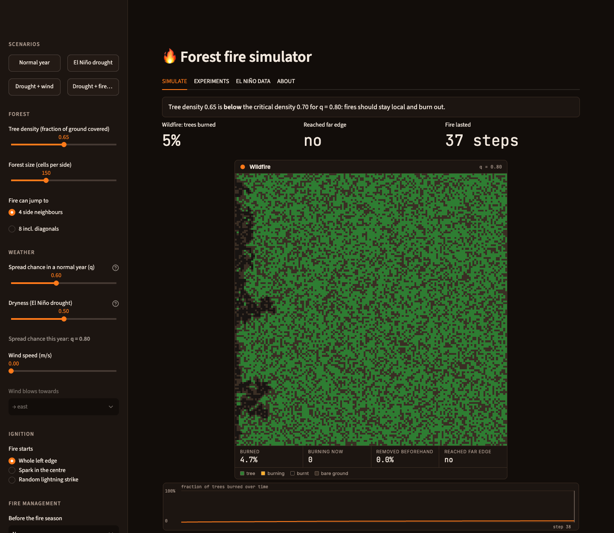
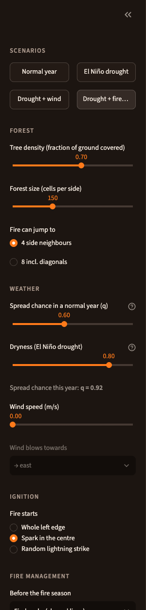
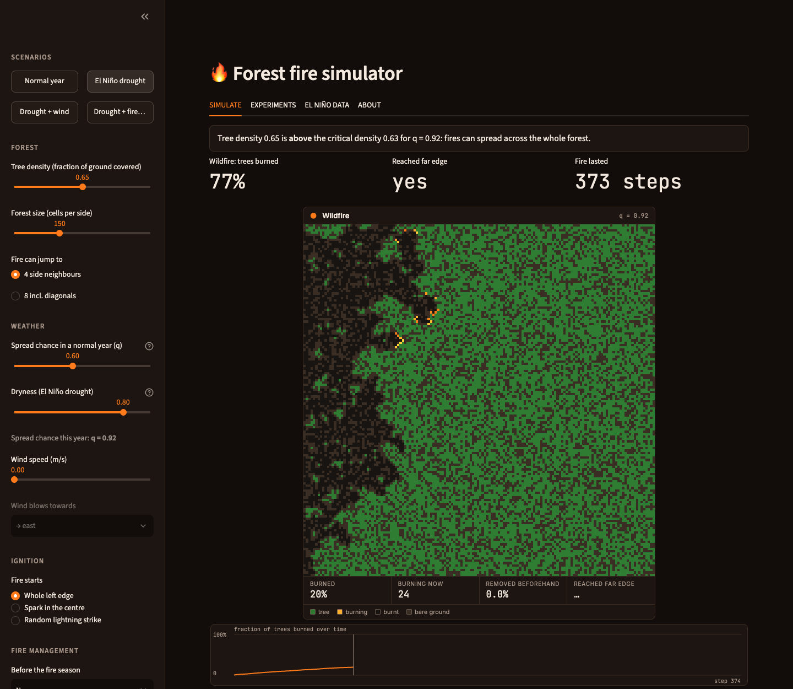
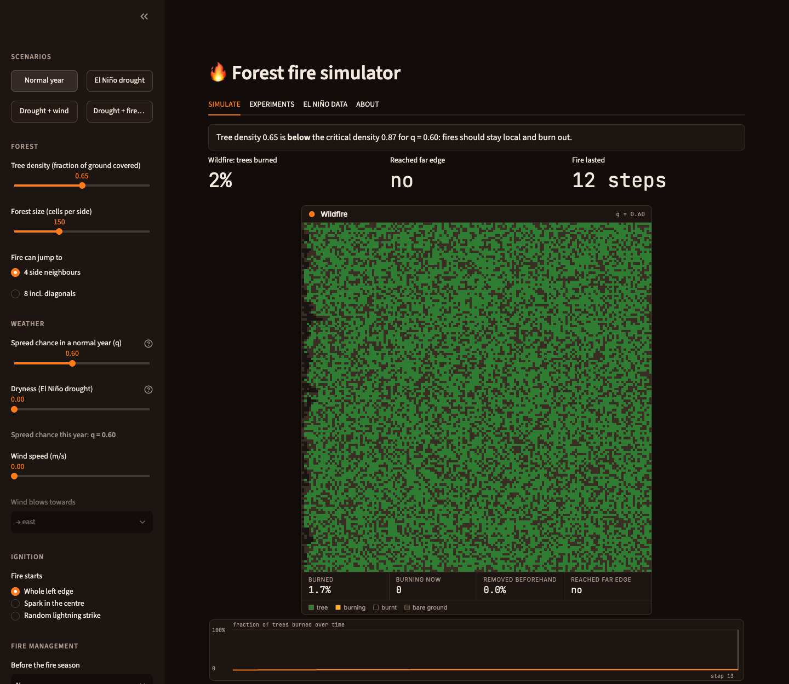
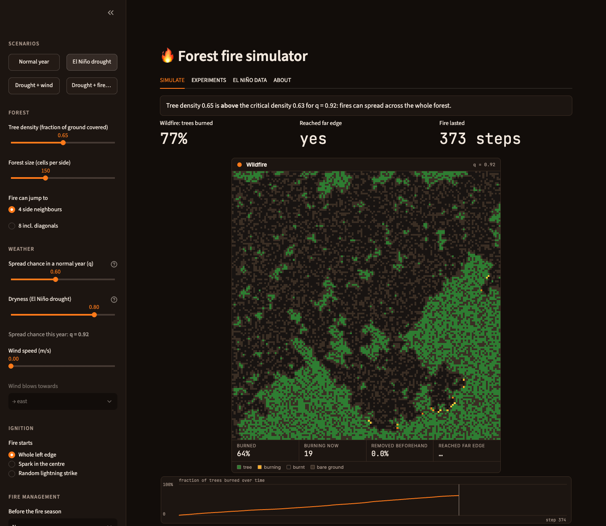
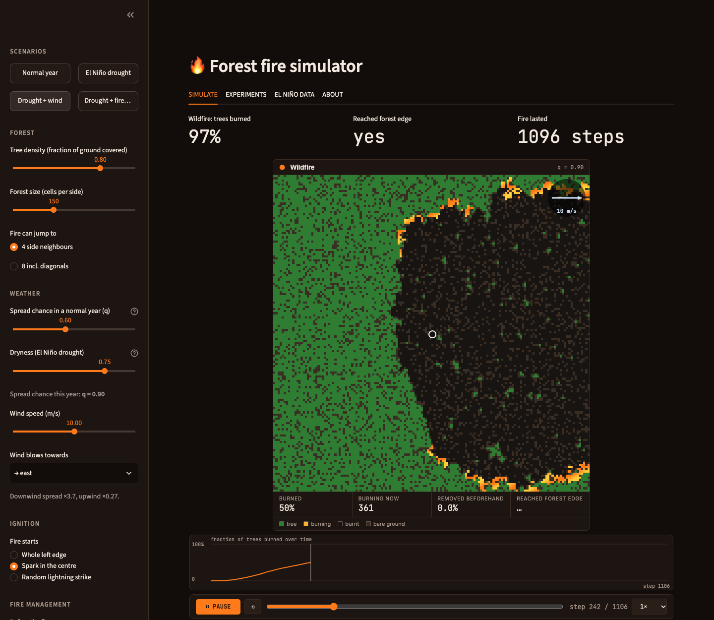
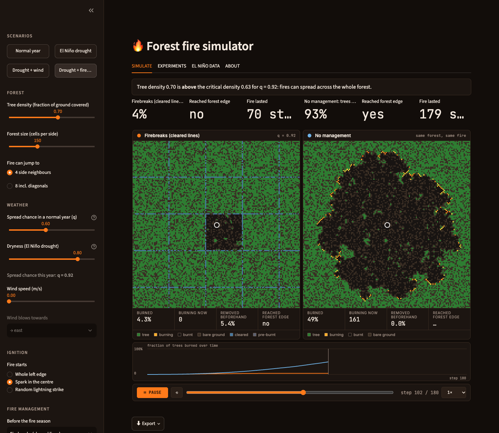
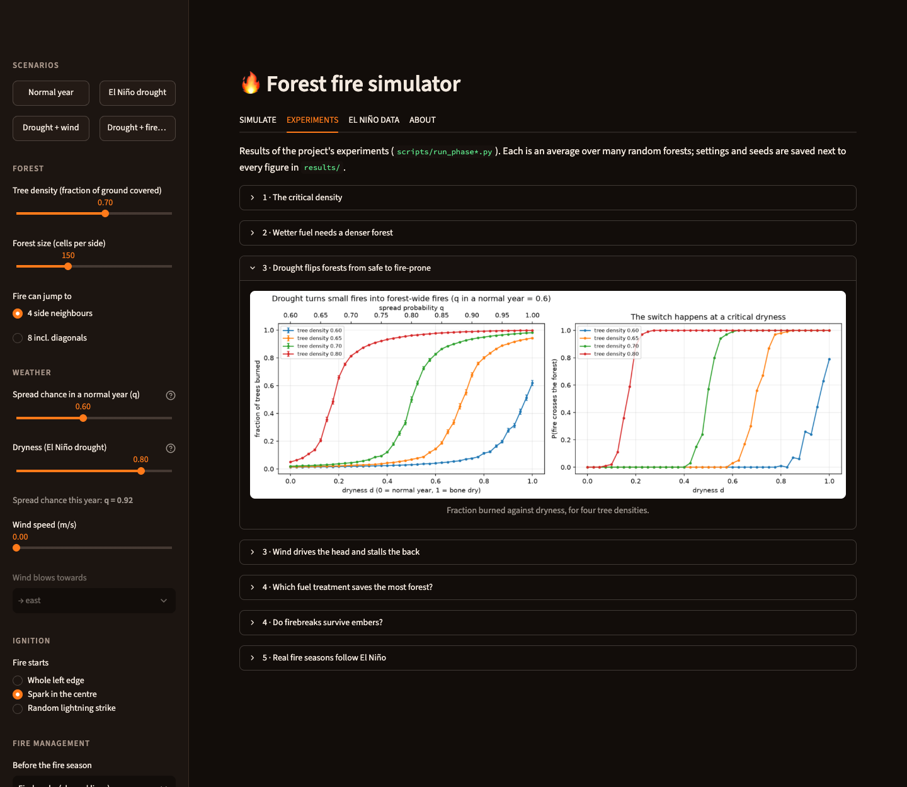
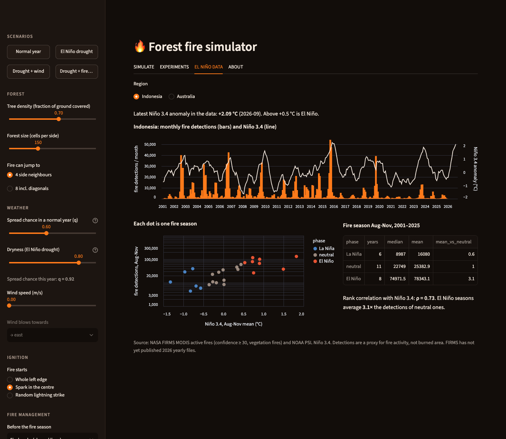

::: {.callout-tip appearance="simple"}
## In one minute

1. In the sidebar under **Scenarios**, press **Normal year**. A fire starts along the left edge and dies out.
2. Press **El Niño drought**. Same forest, drier fuel: the fire now sweeps across.
3. Press **Drought + firebreaks**. Two forests burn side by side. The one with cleared lines loses a few percent; the
   untreated one burns almost entirely.
4. Open the **EL NIÑO DATA** tab to see that real fire seasons in Indonesia follow the same pattern.
:::

# What the app is

The app simulates a wildfire on a grid. Every cell is either bare ground or a tree. Fire starts where you choose, and
at each step every burning tree tries to set fire to its neighbouring trees. Whether the fire dies out or burns the
whole forest depends on a few things you control:

* how dense the forest is;
* how dry the fuel is (El Niño drought makes it drier);
* the wind;
* whether trees were cleared or burned beforehand to protect the forest.

Every run is a fresh simulation. Python computes the whole fire in a fraction of a second, and the browser replays it
so you can pause and scrub. Changing any setting re-runs it straight away.

**Start the app:** from the project folder run `streamlit run app/streamlit_app.py` and open the address it prints
(usually <http://localhost:8501>).

{.column-page}

# The screen at a glance

| Area | What it is for |
|---|---|
| **Sidebar** | Scenarios (one-click presets), then the forest, weather, ignition and management settings |
| **SIMULATE** tab | The verdict line, outcome numbers, the animated fire and the burned-over-time chart |
| **EXPERIMENTS** tab | The project's main results, averaged over many forests |
| **EL NIÑO DATA** tab | Real NASA satellite fire detections against the NOAA El Niño index |
| **ABOUT** tab | A short explanation of the model and its limits |

# Settings (sidebar)

{width=30%}

**Scenarios** load a whole set of settings at once:

| Scenario | What it shows |
|---|---|
| **Normal year** | 65% tree cover with normal fuel: well below the tipping point (about 0.87 for this fuel), so fires stay small |
| **El Niño drought** | The same forest in a drought year: drought lowers the tipping point to about 0.63, below the forest's 0.65 |
| **Drought + wind** | A spark in the centre with a 10 m/s wind blowing east |
| **Drought + firebreaks** | A spark in the centre of a 70%-cover forest, firebreaks on about 6% of it, compared with no management |

**Forest**

* **Tree density:** the fraction of ground covered by trees. This is the most important setting.
* **Forest size:** cells per side. Bigger forests show the tipping point more sharply but take longer.
* **Fire can jump to:** 4 side neighbours, or 8 including diagonals. With diagonals, fire needs far fewer trees to cross.

**Weather**

* **Spread chance in a normal year (q):** the chance that a burning tree ignites a neighbouring tree with normal fuel
  moisture.
* **Dryness (El Niño drought):** 0 = normal year, 1 = bone dry. Drought shrinks the chance that fuel fails to catch.
  The caption shows the resulting spread chance for this year.
* **Wind speed and direction:** fire spreads more easily downwind and less easily upwind. The caption shows the
  multipliers (at 10 m/s: ×3.7 downwind, ×0.27 upwind).

**Ignition**

* **Whole left edge:** the classic test of whether fire can cross the forest.
* **Spark in the centre:** a single ignition, best for watching the fire's shape.
* **Random lightning strike:** a single spark on a random tree. It may land in an isolated clump and fizzle out,
  just as real lightning often does.

**Fire management**

* **Before the fire season:** firebreaks (a grid of cleared lines), random thinning, or controlled burns (square
  patches burned beforehand).
* **Trees removed:** the budget, as a fraction of the forest.
* **Compare side by side with no management:** burns the same forest with the same spark twice, with and without the
  treatment.

**Advanced**

* **Burn duration:** how many steps a tree keeps burning and trying to ignite its neighbours. 1 is the classic model.
  Use 5 or more with wind, otherwise the fire already moves at the grid's speed limit and wind cannot make it faster.
* **Ember chance and reach:** burning trees can throw embers that land several cells away. Embers are how real fires
  jump roads, rivers and firebreaks.
* **Random seed:** the same seed gives the same forest and the same fire; change it for another random forest.

# Watching a fire (SIMULATE tab)

{.column-page}

**The verdict line** (shown when there is no wind and no embers) compares your forest with the **critical density**
for this year's spread chance, measured in the project's experiments:

* *above:* fires can spread across the whole forest;
* *below:* fires should stay local and burn out;
* *right at:* fires are unpredictable and long.

**Outcome numbers:** the share of trees burned, whether the fire reached the far edge (edge ignition) or any edge of
the map (spark ignition), and how many steps it lasted.

**The map:**

| Colour | Meaning |
|---|---|
| Green | Tree that has not burned (yet) |
| Orange / yellow (flickering) | Burning now |
| Very dark brown | Burnt |
| Brown | Bare ground (no tree) |
| Blue | Cleared by firebreaks or thinning |
| Grey-blue | Burned beforehand in a controlled burn |

A white circle marks a single spark. With wind, an arrow in the top-right corner shows where the wind blows.

**Under the map:** live counters for the share burned so far, trees burning right now, trees removed beforehand, and
the edge result. The **chart** shows the fraction burned over time.

**Controls:** **▶ PLAY / ⏸ PAUSE**, **⟲** to restart, the slider to jump to any step, and the speed menu (0.5× to 4×).

::: {.callout-note}
**Watch the end, not only the middle.** Near the tipping point a fire can look as if it is dying and then find a
path and break out, or the reverse. The numbers above the map are the final result.
:::

# Three guided experiments

## Find the tipping point

1. Press **Normal year**. Note the verdict (*below*) and the small burned share.
2. Raise **Tree density** a few hundredths at a time and watch the verdict and the burned share. Near the critical
   density (about 0.87 for this fuel) the fire suddenly breaks through. Near the tipping point fires also last much longer, because
   they follow long, winding paths.
3. Now leave density alone and raise **Dryness** instead: drought moves the tipping point down to meet the forest.

{width=49%} {width=49%}

## See what wind does

Press **Drought + wind**. The spark is in the centre and a 10 m/s wind blows east. The fire races downwind and
reaches the right edge first. It creeps only slowly upwind, and the burnt area is egg-shaped with the spark near its
back. Try other directions, or set the wind to 0 for comparison (the fire then spreads evenly in all directions).

{.column-page}

## Compare fire management

Press **Drought + firebreaks**. The left map has cleared lines on 6% of the forest; the right map is the same forest
and spark with no management. The fire on the left is trapped in the compartment where it started.

{.column-page}

Then try:

* **Random thinning** or **controlled burns** with the same budget: both save far less forest.
* Raising the thinning budget past about 10%: once thinning pushes the forest below the tipping point, fires
  suddenly stop.
* Under **Advanced**, adding embers (e.g. 5% chance, 10 cells reach): widely spaced firebreaks start to fail, so you
  need a bigger budget, i.e. closer breaks.

# Experiments tab

The **EXPERIMENTS** tab shows the project's results, each averaged over many random forests:

* the tipping point;
* how fuel moisture moves it;
* drought and wind;
* the fire-management comparison and the ember test;
* the real-data comparison.

They answer "what happens on average?", whereas the simulator shows one forest at a time.

{.column-page}

# El Niño data tab

{.column-page}

* **Region:** Indonesia (fire season Aug–Nov) or Australia (Sep–Dec).
* **Top chart:** satellite fire detections per month (bars) and the Niño 3.4 index (line). Above +0.5 °C is El Niño,
  below −0.5 °C La Niña. The latest value in the data is shown above the chart.
* **Scatter:** one dot per fire season, coloured by El Niño, neutral or La Niña. Note the log scale: each grid line up
  is several times more fire.
* **Table:** how many seasons fall in each phase, their median and mean detections, and the ratio to neutral years.
  Indonesia's El Niño seasons average about 3× the fire activity of neutral ones.

A detection is a 1 km pixel seen burning by NASA's Terra or Aqua satellite, a proxy for fire activity rather than
burned area. NASA had not yet published 2026 in its yearly archive, so the current season is not included.

# Exporting

The **⬇ Export** menu under the fire offers:

* **Replay (standalone HTML):** the animated fire as a single file that opens offline in any browser.
* **Scenario settings (JSON):** every setting and the seed, so the run can be reproduced exactly.

# Troubleshooting

| You see… | Why, and what to do |
|---|---|
| A lightning fire that burns almost nothing | The spark landed in an isolated clump of trees. Change the seed under **Advanced** |
| Wind makes little difference | Set **Burn duration** to 5 or more |
| No verdict line | It only appears without wind and embers, where the critical density is known |
| "Compare" is greyed out | Choose a management strategy first |
| The El Niño tab asks to download data | Run `python scripts/download_real_data.py` once (about 600 MB, 4 minutes) |

# Glossary

| Term | Meaning |
|---|---|
| **Tree density (p)** | Fraction of ground covered by trees |
| **Spread chance (q)** | Chance that a burning tree ignites a neighbouring tree |
| **Critical density / tipping point** | The density above which fire can cross the whole forest |
| **Dryness** | Drought strength, 0 (normal) to 1 (bone dry) |
| **Firebreak** | A cleared line with no fuel |
| **Thinning** | Removing trees at random to lower the density |
| **Controlled burn** | Burning a patch on purpose in mild conditions so it has no fuel later |
| **Ember spotting** | Burning material carried by wind, starting fires beyond the front |
| **Niño 3.4** | Sea-surface temperature anomaly in the central Pacific; the standard El Niño index |

For the science and full results, see the companion report, *When Forests Catch Fire* (`report/report.html`).
